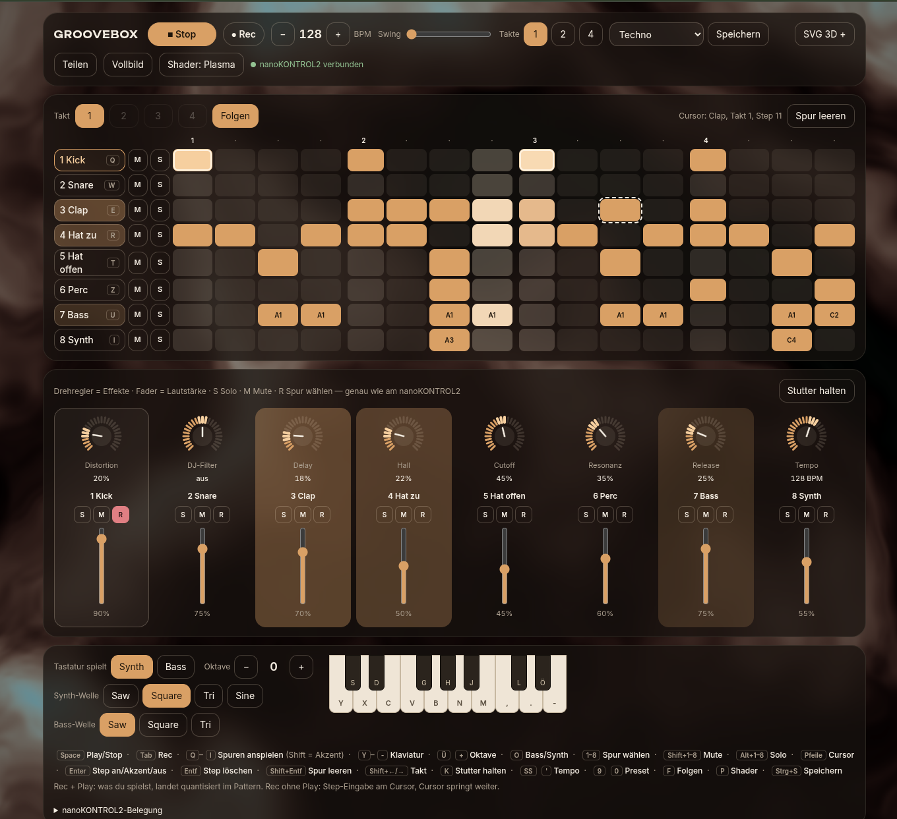

# Groovebox

A drum machine, synth and effects rack that runs in a single HTML file. Play it with your computer keyboard or a **Korg nanoKONTROL2**, build beats in a step sequencer, drop in SVGs that turn into 3D objects, and show audio-reactive shader visuals fullscreen on any phone, TV or projector in your network.

**Try it:** https://seakuh.github.io/groovebox/ (Chrome or Edge recommended for Web MIDI)



> The interface is in German. Key labels adapt to your keyboard layout automatically.

## Features

- **8 tracks:** kick, snare, clap, closed hat, open hat, perc, bass, polyphonic synth. All sounds are synthesized with the Web Audio API, no samples.
- **Step sequencer** with 1, 2 or 4 bars, accents, swing, and a stutter/beat-repeat you can hold.
- **Live recording:** with Rec + Play, what you play is quantized into the pattern. With Rec while stopped, you enter steps at the cursor.
- **Effects:** distortion, DJ filter (low-pass/high-pass on one knob), tempo-synced delay, reverb, and synth cutoff, resonance and release.
- **Presets:** Techno, House, Hip-Hop, Trap, Drum & Bass, Acid, Breakbeat. Save your own beats with Ctrl+S.
- **nanoKONTROL2 mapping out of the box.** The on-screen mixer mirrors the hardware, and every MIDI move jumps to and highlights the control you touched.
- **Other MIDI gear:** any MIDI keyboard plays the synth, and drum pads on channel 10 play the drums.
- **Visuals:** WebGL shaders (plasma, tunnel, horizon) that react to kick and bass.
- **SVG → 3D:** drag SVG files onto the window and they get extruded into 3D objects that dance to the music.
- **Fullscreen view in your network:** share a QR code and link, and other devices see the visuals in sync.

## Quick start

No build step and no dependencies. Node 18 or newer is only needed for the network view.

```bash
git clone https://github.com/Seakuh/groovebox.git
cd groovebox
npm start
```

Open http://localhost:8787 and click once or press a key to start audio. Click **Teilen** (share) to get the QR code and link for other devices on the same Wi-Fi.

Without Node, you can open `index.html` directly in Chrome. Everything works except the network view.

## Keyboard

| Key | Action |
| --- | --- |
| `Space` | Play / stop |
| `Tab` | Record |
| `Q W E R T Y U I` | Trigger tracks 1–8 (Shift = accent) |
| `Z S X D C V G B H N J M , L . ; /` | Piano (QWERTY positions) |
| `[` `]` | Octave down / up |
| `O` | Switch keys between synth and bass |
| `1–8` / `Shift+1–8` / `Alt+1–8` | Select / mute / solo track |
| Arrow keys, `Enter`, `Delete` | Move cursor, set step (on → accent → off), clear step |
| `Shift+←/→` | Switch bar |
| `K` (hold) | Stutter |
| `-` `=` | Tempo |
| `9` `0` | Previous / next preset |
| `P` / `F` | Next shader / follow playhead |

## nanoKONTROL2 mapping

Uses the factory default scene (CC mode, any channel).

| Control | Function |
| --- | --- |
| Faders 1–8 | Track volume |
| Knobs 1–8 | Distortion, DJ filter, delay, reverb, cutoff, resonance, release, tempo |
| S / M / R | Solo / mute / select track |
| Play, Stop, Rec | Transport |
| Cycle (hold) | Stutter |
| Track ◀ ▶ | Select track |
| Marker ◀ ▶ | Previous / next preset |
| Set | Clear selected track |
| ⏪ ⏩ | Switch bar |

Button LEDs follow the app if you set **LED Mode: External** in the Korg Kontrol Editor.

## How the network view works

`server.js` is a small Node server with no dependencies. It serves the app and relays the live state (audio level, kick, playhead, shader, dropped SVGs) to viewers via Server-Sent Events. Only the browser on the same machine (`localhost`) can send state, so other devices in the network can watch but not take over.

## Third-party

These are loaded from public CDNs at runtime:

- [three.js](https://threejs.org) (MIT), used for the SVG → 3D layer
- [qrcode-generator](https://github.com/kazuhikoarase/qrcode-generator) (MIT), used for the share QR code
- [Inter](https://rsms.me/inter/) and [Unbounded](https://github.com/googlefonts/unbounded) via Google Fonts (SIL Open Font License)

Korg and nanoKONTROL2 are trademarks of Korg Inc. This project is not affiliated with or endorsed by Korg.

## License

[MIT](LICENSE) © 2026 Daniel Grimm
